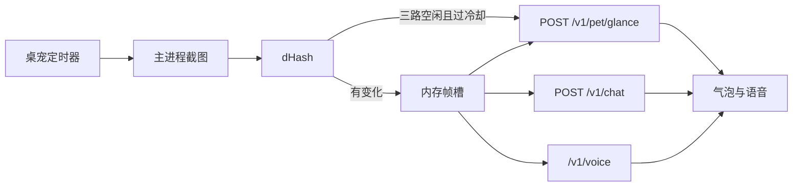

# 桌宠看桌面

桌宠在开关打开后持续看星奈所在的那块屏幕。空闲时她可以主动用气泡说一句，语音播报开着就念出来。老师仍用现在的打字、按住说话和实时语音跟她说话；这三路在这一轮带上刚看到的画面。

本文只定设计和以后的改法。当前代码还没有这条能力。

## 目标

- 看桌面只存在于桌宠会话（`kind: "chat"`）。
- 老师用现有三种方式发话，回复形式保持今天的习惯。
- 屏幕是这一轮的上下文，不是老师发出的附件。
- 像素只留在 agent 进程内存里，重启即失。

## 不做的事

- 工作台不采样、不调用 `/v1/pet/*`、不展示看桌面开关。`kind: "desk"` 的会话调用这两条路由时直接拒绝。
- 不把桌宠会话和工作台会话连起来，也不把画面摘要写进全局记忆。记忆仍然全局，所以更不能把屏幕上的字当成「老师说过的话」。
- 不新做输入框、麦克风或第二条实时语音通道。桌宠上现有的「实时」按钮是 `/v1/voice` 语音双工，不是看屏幕。
- 不改 `personas/default`。屏幕规则只在这一轮的系统提示末尾追加一段。
- 不改知识库切分，不改 `packages/agent/src/eval/baseline.json`。
- 不把截图放进 `POST /v1/chat` 的 `images`。那样会走进 `saveMessageImages`、`imageTurnRetrieval`，并打断「上一张用户附图」的 lookback。屏幕和用户附图是两条字段。
- 不使用 `getUserMedia` / `getDisplayMedia`。主进程现在的媒体权限会拒绝 `video`（`apps/desktop/src/main/index.ts`）。截图走 `desktopCapturer` 的缩略图。
- 第一版不设单独的视觉模型字段，也不在设置里放间隔、冷却、清晰度旋钮。

## 用户可见行为

设置里增加一组「桌面」，只有一项「看着桌面」，默认关。关掉时行为与现在完全一致。

打开后：

1. 若系统还没给屏幕录制权限，桌宠状态栏写明需要授权，三路输入照常可用，只是这一轮没有画面。权限对话框由系统弹出，应用不自己做第二套说明页。授权之后，下一轮采样间隔会自己继续，不必重启。
2. 老师什么都不说时，画面相对上一眼有变化，并且过了说话冷却，星奈才可能说一两句。多数采样保持沉默，不出现空泡，也不播无声的语音。
3. 她说话时打开现有对话坞，用现有打字机气泡。`voice.ttsEnabled` 为真时走现有语音播报；为假时只有气泡。
4. 老师打字：仍只出气泡，不因为看桌面而自动播报。这一轮能看见新鲜画面。
5. 老师按住说话：仍先转写，再气泡加播报。这一轮能看见新鲜画面。
6. 老师开着实时语音：整个实时会话期间她不主动插话，采样继续。识别出的下一句能看见新鲜画面。老师改打字时，仍按今天的行为退出实时语音。
7. 老师自己贴的图仍按现在的规则预览、发送、落库，上限仍是 4 张（`CHAT_IMAGE_MAX_COUNT`）。屏幕帧不占这个额度。
8. 关掉开关、退出应用或删掉当前会话后，内存里的画面丢掉。下次打开不会接着评论关掉前的屏幕。

主动说的那句记入当前桌宠会话的助手消息，下次打开会话还能看见。不制造「老师发来了一张屏幕」这种用户消息，会话标题仍只由老师的第一句决定。

## 架构

采样在主进程，是否发话在桌宠渲染进程判断，画面和回合在 agent 进程。渲染进程知道哪一路输入正忙；agent 知道哪一帧还新鲜。两边都要挡，避免只靠一边。



职责：

| 位置 | 职责 |
| --- | --- |
| 桌宠渲染进程 | 20 秒定时器；知道打字、按住说话、实时语音、生成和播报是否占用；决定要不要上传、要不要 glance |
| 主进程 | 按星奈所在显示器截一张 JPEG；排除自身窗口；返回字节和哈希 |
| 预加载 | 截图 IPC；`POST /v1/pet/screen`；glance 用单独的 `AbortController` |
| agent | 帧槽；glance；用户回合和实时语音在回合开始时读槽 |

工作台渲染进程不引用这些 API。

## 采样与系统权限

主进程提供一次性 IPC，例如 `hoshi:capture-screen`。不在主进程里做「她该不该说话」的判断。

步骤：

1. 读 `systemPreferences.getMediaAccessStatus("screen")`。`denied` 或 `restricted` 时返回失败原因，不反复弹出系统框。`not-determined` 时调用 `desktopCapturer.getSources`，让系统出一次授权框。
2. 用 `screen.getDisplayMatching(mainWindow.getBounds())` 确定星奈所在显示器，在 `types: ["screen"]` 的源里用 `display_id` 对齐。对不上时用第一块屏幕源。没有源则失败。
3. `thumbnailSize` 的宽和高都设为长边 1280，由 Electron 保持比例。输出 `image/jpeg`。
4. 在主进程把缩略图收成灰度小图，算 dHash，把 JPEG 与哈希一起返回。渲染进程不自己解码。

开关从关到开时，先给需要排除的窗口打开内容保护，再开始第一轮采样，避免第一张图拍进星奈自己的气泡。

内容保护：

- 打开开关期间，桌宠主窗口、设置窗口、提醒气泡窗口 `setContentProtection(true)`。
- 工作台窗口不保护。老师正在用工作台时，画面里就应该有工作台。
- 关掉开关后恢复 `false`。
- macOS 与 Windows 靠这个接口把窗口剔出采集。Linux 上该接口可能无效，第一版以 macOS 为准，Linux 只保证不崩。

权限文案：在 `apps/desktop/package.json` 的 `mac.extendInfo` 增加 `NSScreenCaptureUsageDescription`，说明星奈需要录屏才能看着桌面聊天。与现有的麦克风说明并列。

开发态（`electron .`）的录屏权限挂在当前 Electron 二进制上。升级 Electron 后系统会把它当成新程序，需要重新授权。打包后的 Hoshi 单独授权。

失败时状态栏说明原因，定时器可以继续，但连续失败不调用模型。打字、按住说话、实时语音不依赖截图成功。

其他画面情况：

- 多显示器：只截星奈窗口中心所在的那一块，不拼整面墙。
- 锁屏或全黑：哈希会变一次，她至多评论一次；画面稳住后不再说。不单独识别「这是锁屏」。
- 窗口拖到另一块屏幕：下一轮采样跟着新显示器。
- 星奈窗口本身是透明置顶窗口。内容保护就是为了避免她评论自己的气泡。

## 变化检测

dHash 做成不依赖 Electron 的纯函数：输入一组灰度采样，输出 64 位哈希。汉明距离小于或等于阈值视为同一画面。

主进程适配只负责把 `NativeImage` 缩成纯函数要的采样。单测覆盖纯函数：相同图距离为 0，改一个角距离上升，全黑与全白距离很大。

渲染进程拿到哈希后：

- 与上一张已上传的哈希距离不超过阈值：不上传，不 glance。
- 超过阈值：上传。是否 glance 还要看下面的空闲条件和冷却。

采样定时器固定 20 秒。另外设 8 秒下限：实现里任何路径都不得把间隔调得比 8 秒更密。

## 帧槽

agent 进程内最多保留一帧：

```ts
type PetScreenFrame = {
  sessionId: string;
  mime: "image/jpeg";
  data: string;
  hash: string;
  at: number;
};
```

规则：

- 新上传替换旧帧。`sessionId` 改了也替换，旧像素不保留。
- 只服务这一帧上的 `sessionId`。别的会话读不到。
- 超过帧有效期视为没有帧。
- 关掉开关、删除该会话、进程退出时清掉。
- 不写 `hoshi.db`，不写消息图片表，不写磁盘缓存。
- 日志只记会话、哈希、字节数和是否替换。不打印 base64，不打印画面里的文字。

上传接口在哈希未变时可以不发。服务端仍再算一次哈希：与槽里相同则不替换，避免重复写入。

## 协议

沿用本机 agent 的现有鉴权。路由只加在 `packages/agent/src/server.ts`，预加载同步暴露。工作台的预加载类型里不增加这两项。两条路由的请求类型放在 `packages/shared/src/sse.ts`，与现有 `ChatRequestBody` 并列，不复用它的 `images` 字段。

### 设置

`HoshiSettings` 增加：

```ts
screen: {
  enabled: boolean;
}
```

`DEFAULT_HOSHI_SETTINGS.screen.enabled` 为 `false`。`resolveHoshiSettings` 在旧配置没有 `screen` 时补上 `false`。设置窗口的保存与回填走现有 `settings.ts` 路径。

常量放在 `@hoshi/shared`，桌面和 agent 共用，避免两处各写一个间隔：

| 常量 | 值 | 含义 |
| --- | --- | --- |
| `intervalMs` | 20000 | 采样间隔 |
| `minIntervalMs` | 8000 | 间隔下限，实现不得更密 |
| `cooldownMs` | 60000 | 两次主动说话的最短间隔 |
| `frameTtlMs` | 30000 | 帧超过这个时间就不再贴进用户回合 |
| `maxEdge` | 1280 | 缩略图长边 |
| `jpegQuality` | 60 | JPEG 质量 |
| `hashThreshold` | 10 | dHash 汉明距离，小于等于它视为没变 |

### `POST /v1/pet/screen`

请求：`{ sessionId, mime, data, hash }`。只更新帧槽，不调用模型。

- 会话不存在：错误。
- `session.kind !== "chat"`：错误。
- 开关关掉：错误，并清槽。
- `mime` 只接受 `image/jpeg`。字节超过现有单张图片上限（`CHAT_IMAGE_MAX_DATA_CHARS`）则拒绝。
- 成功：`{ ok: true, stored: boolean }`。`stored` 为假表示哈希未变。

### `POST /v1/pet/glance`

请求：`{ sessionId }`。响应使用现有 SSE：`sentence`、`emotion`、`done`、`error`。不新增事件类型。沉默就是一条不带 `sentence` 的 `done`。

服务端在调用模型前再挡一层：

- 会话不是 chat，或开关关掉，或没有未过期的帧：`error`，状态栏可显示。
- 这一帧的哈希已经评论过，或距离上次主动说话未满冷却：直接 `done`，不调用模型。
- 模型表示不说：`done`，不写消息。
- 模型说了：按现有句事件往外推，并把助手全文写入该会话。不写用户消息，不抽记忆，不开检索，不给工具，不开画布。

客户端用单独的 `AbortController` 发 glance。老师一开始发话就 abort 这个请求。不得调用预加载里那条会把上一轮 `chat()` 一起 abort 的 `hoshi.chat()`。

abort 时：还没有任何 `sentence` 就不落库；已经说出的句子按已推送的文本落成助手消息。

模型输出先收成结构化结果再决定发不发句事件，便于单测：

```ts
type PetGlanceDecision = {
  speak: boolean;
  text: string;
  emotion: Emotion;
};
```

`speak === false`、正文为空或解析失败，都按沉默处理。解析失败不把原始 JSON 塞进气泡。

## 用户回合如何带上画面

`POST /v1/chat` 和 `/v1/voice` 都不在请求体里再传屏幕。回合开始时由 agent 自己读槽。

读槽条件同时成立才贴上：

- `screen.enabled`
- 槽的 `sessionId` 与这一轮相同
- `now - at <= frameTtlMs`

贴进模型的用户内容是：老师的原文、老师自己的附图、一句固定说明「这是星奈刚看到的桌面，不是老师发来的图片」、然后才是屏幕 JPEG。写进数据库的用户消息只有老师的原文；`saveMessageImages` 只存老师的附图。

因此：

- `canExtractMemory` 仍只看老师原文。画面上的字不会变成抽取输入。
- `imageTurnRetrieval` 仍只在老师附图非空时生效。只看屏幕、老师没贴图时，检索按老师这句话本身决定，不走「这是一张图所以少检索」的分支。
- lookback 仍只回溯老师以前贴过的图。屏幕帧不在图片表里，下一轮不会把旧屏幕再贴回来。

实时语音在 `packages/agent/src/voice/attach.ts` 的 `runTurn` 里，`buildHistory` 之后、`runSessionChat` 之前读取同一槽。依赖用函数注入，例如 `takeScreen(sessionId)`，单测不必拉起 WebSocket。

`runSessionChat` 增加可选的 `screen` 参数，传入 runtime。runtime 把屏幕拼进这一次的模型消息，不写入 `body.images`。

带屏幕的这一轮在系统提示末尾追加一段，只存在于这次请求：

> 你刚看了一眼老师的桌面。老师没提画面时，不要主动复述屏幕。老师问到眼前的内容时，按画面回答。不要朗读密码、验证码、密钥、证件号、私聊和邮件全文。

人设文件不动。

## 主动评论

glance 使用同一次追加提示，并再加一段：

> 这是空闲时的一眼。多数时候保持沉默，输出不说话。只有画面明显变了，而且值得关心或真的想问一句时，才说一两句口语。不要报菜名式描述整个桌面。

调用现有对话模型，带这一帧，不带工具。情绪沿用现有 `Emotion`。桌宠渲染进程收到 `sentence` 后走现有打字机和 `setPetEmotion`。

语音：glance 的播报复用桌宠里 `runAssistantTurn` 已经在用的 TTS WebSocket（`type: "speak"` / `type: "finish"`），不新开语音引擎。实时语音进行时根本不会发 glance，因此不会和 `/v1/voice` 的播报抢同一路。

冷却从「这一次确实说出了句子」起算 60 秒。沉默不刷新冷却，否则她会在一段变化后一直沉默到下一分钟才重新考虑。同一哈希只评论一次，避免画面停住以后每分钟重复。

## 谁先说话

渲染进程在下面任一情况不发 glance，采样和上传仍可进行：

- 实时语音会话开着（从连接成功到关掉，含聆听）
- 按住说话的录音或转写还没结束
- 输入框里有尚未发送的字
- 打字或按住说话触发的生成还没结束
- 气泡打字机还在跑，或语音播报还没结束
- 上一次 glance 还没结束

老师发话与 glance 撞上时，只 abort glance。正在进行的 `POST /v1/chat` 或 `/v1/voice` 回合不被看桌面掐断。

打字发送今天会关掉实时语音。看桌面不改变这一点。

服务端冷却和「这一哈希已评论」是第二道门。渲染进程崩溃重连或定时器重入时，不会因此连说两句。

## 隐私与记忆

- 画面不是老师的原话，不进入 `extractLongTermOps`。
- 提示词禁止把密码、验证码、密钥、证件号、银行卡和私聊原文说出来。
- 像素不落盘。关开关、换会话、删会话、退出都会清槽。
- 主动说出的助手文本会留在会话里。若模型仍然说漏了敏感内容，留下的是这句文本，不是图片。这是已知残余风险。
- 本机路由继续只听 `127.0.0.1`，并走现有 agent 鉴权。不增加局域网入口。

老师自己打出「我的密码是……」仍按现有记忆规则处理，与看桌面无关。

## 模型

使用设置里的当前对话模型，不新增视觉模型配置。模型必须接受图像输入。拒绝图像或超时的错误用现有 `error` 事件回到桌宠状态栏，例如「当前模型不能看图」。不自动改模型，不静默改成纯文本再答。

主动评论和老师发问都会消耗视觉接口额度。默认 `pnpm test` 不发起这类请求。

## 失败与降级

| 情况 | 行为 |
| --- | --- |
| 录屏权限被拒或受限 | 状态栏说明；停止上传和 glance；三路输入可用 |
| 没有显示器源 | 同上，下一间隔再试 |
| 开关关闭 | 清槽；路由拒绝新的上传和 glance |
| 帧超过 30 秒 | 用户回合不贴画面；glance 不说话 |
| 画面没变 | 不上传；不 glance |
| 模型拒图、超时、额度错误 | `error` 显示在状态栏；不写空助手消息 |
| 模型沉默或输出无法解析 | `done`，无气泡 |
| glance 途中老师发话 | 只取消 glance；已说出的句子保留 |
| agent 进程重启 | 槽为空；下一轮采样重新上传 |
| 会话被删 | 清槽 |
| 工作台误调路由 | 拒绝 |

## 实现顺序

每一步都可以停。前一步的单测没过，不开始下一步。

1. **采样。** 主进程 IPC、内容保护、权限结果、dHash 纯函数。不调模型。用单测锁住哈希和「距离不超过阈值就不该上传」的判断。
2. **帧槽与 glance。** shared 类型和常量、`resolveHoshiSettings`、两条路由、沉默解析、拒绝 desk、不写图片、不抽记忆。用假模型测 glance。
3. **三路输入。** `runSessionChat` / runtime 在回合开始时读槽；语音 `runTurn` 注入同一函数。老师附图的落库和 lookback 保持原样。
4. **主动说话。** 桌宠定时器、空闲判断、单独 abort、气泡和现有 TTS。实时语音期间不发 glance。
5. **在 Electron 里走通。** 见下方手工路径。浏览器替代不了录屏权限。

每步跑 `pnpm test`，以及改动包的 `typecheck`。

### 单测要锁住的行为

- 相同采样哈希距离为 0；明显不同的图距离大于阈值。
- 旧配置没有 `screen` 时开关为关。
- 槽：替换、session 不匹配读不到、过期读不到、关闭和删除会清。
- 带屏幕的用户回合：数据库里的用户正文不含屏幕说明，图片表没有这张 JPEG，记忆抽取的输入仍是老师原文。
- 老师只发了附图时，`imageTurnRetrieval` 的选择与现在一致。
- desk 会话调用两条 pet 路由被拒绝。
- glance：沉默不产生 `sentence`、不写消息；说话会写助手消息且没有对应的假用户消息；冷却内第二次不调用模型。

### 手工路径

在真桌宠上确认：

- 拒绝录屏权限后，打字仍能聊，状态栏有说明。
- 授权后，静止桌面不会连续说话。
- 切换到一块明显不同的画面，空闲时至多主动说一轮，然后进入冷却。
- 打字问眼前的内容能答上；语音播报不会因为打字而打开。
- 按住说话问眼前的内容，有气泡也有语音。
- 实时语音问眼前的内容能答上；实时语音开着时她不另起一句看屏评论。
- 生成过程中画面变化，不会把正在进行的回答掐掉。
- 自己贴一张图发送，图片仍保存；屏幕帧不出现在消息图片里。
- 关掉开关后再问，回答不再依赖刚才的画面。
- 工作台对话没有看桌面，也不会出现相关开关。

## 将要改的文件

实现时才改这些位置。写本文档时不动它们。

- `packages/shared/src/settings.ts`：`screen.enabled` 与 `resolveHoshiSettings`。
- `packages/shared/src/sse.ts`：`/v1/pet/screen` 与 glance 的请求类型。屏幕帧不进 `ChatRequestBody.images`，也不新增 SSE 事件种类。
- `packages/shared` 中的常量与 dHash 纯函数，以及旁边的 `*.test.ts`。
- `packages/agent/src/server.ts`：两条路由。
- `packages/agent/src/chatTurn.ts`、`packages/agent/src/runtime.ts`：回合开始时贴帧。
- `packages/agent/src/voice/attach.ts`：`runTurn` 读同一槽。
- 新建的帧槽、glance 决策和对应单测，放在 `packages/agent/src/` 下与实现同目录。
- `apps/desktop/src/main/index.ts`：截图 IPC、内容保护、权限状态。
- `apps/desktop/src/preload/index.ts`：截图、上传、独立的 glance。
- `apps/desktop/src/renderer/index.ts`：定时器、空闲判断、气泡和 TTS。
- `apps/desktop/src/renderer/settings.ts` 与设置页标记：一组「桌面」、一个复选框。
- `apps/desktop/package.json`：`NSScreenCaptureUsageDescription`。

明确不改：`personas/default`、`apps/desktop/src/renderer/workbench/`、知识库切分、`packages/agent/src/eval/baseline.json`。
